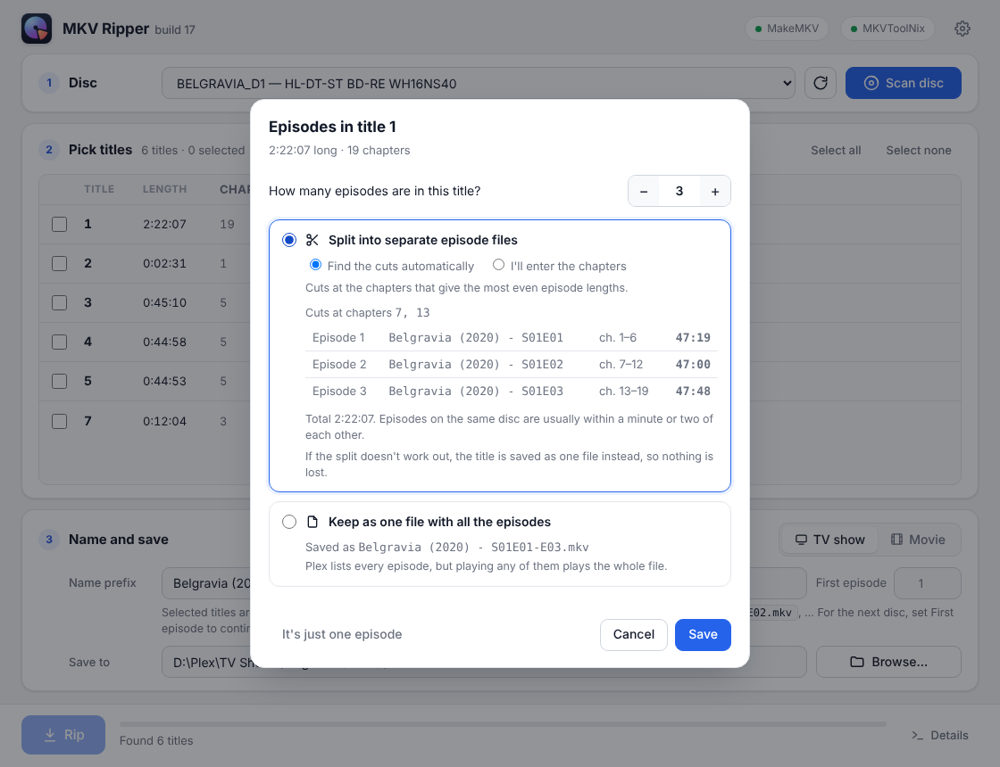

# MKV Ripper

A small Windows and Mac front end for MakeMKV that rips the titles you pick and names them for Plex.

- **TV mode:** give a prefix (e.g. `S1E` or `Belgravia (2020) - S01E`) and a first episode number. Checked titles are saved as `S1E1.mkv`, `S1E2.mkv`, …
- **Split titles:** if a disc stores several episodes as one big title, say how many episodes it holds. MKV Ripper picks the chapters that give the most even episodes, or you type them yourself (e.g. `7,13`). Either way it shows each episode's length before anything is split, and flags an episode that's much longer or shorter than the rest. On a DVD the chapter times come from the disc's own files when you scan, so you see the lengths before ripping. If they can't be read, the rip pauses after copying the title so you can check the lengths (and change the chapters) before it splits. MKVToolNix then splits losslessly and each piece gets the next episode number.
- **Movie mode:** give the movie name and year (e.g. `The Matrix (1999)`). The first checked title is saved as `The Matrix (1999)/The Matrix (1999).mkv`; any other checked titles are saved beside it as Plex extras (`Extra 1-other.mkv`, …).

## Download and run (Windows)

1. Go to [Releases](https://github.com/vagend/makeMKV-GUI/releases/latest) and download **MKVRipper-setup.exe**. No Python needed.
2. Run it. It installs just for you (no admin prompt), adds **MKV Ripper** to the Start menu, and can be removed from **Settings > Apps**. (Or download **MKVRipper.exe** to run it without installing.)
3. Open MKV Ripper. If MakeMKV or MKVToolNix isn't installed, the app offers to install it with Windows Package Manager (winget). Windows may ask for permission.

Windows SmartScreen may warn about the download because it isn't code-signed. Click **More info > Run anyway**.

## Download and run (Mac)

1. Go to [Releases](https://github.com/vagend/makeMKV-GUI/releases/latest) and download **MKVRipper-mac-AppleSilicon.dmg** for an M1 or newer Mac, or **MKVRipper-mac-Intel.dmg** for an Intel Mac (Apple menu > About This Mac shows which you have).
2. Open the .dmg and drag **MKV Ripper** onto the **Applications** folder beside it. If you forget and open it from somewhere else, it offers to move itself into Applications (it has to live there to update itself). The .zip files on the release are what the app downloads to update itself.
3. The first time you open it, macOS says it can't verify the app (it isn't signed with a paid Apple developer account). Click **Done**, open **System Settings > Privacy & Security**, scroll down and click **Open Anyway**. You only do this once; updates install themselves.
4. Install **MakeMKV** from [makemkv.com](https://www.makemkv.com/download/) (Homebrew no longer offers it). For splitting, the app installs **MKVToolNix** with Homebrew if you have it, or opens its download page.

macOS may ask once for permission to read the disc or the folder you save to; click **Allow**.

### Staying up to date

- **The app** checks GitHub for a newer release when it starts and offers to update and restart.
- **MakeMKV and MKVToolNix:** use the buttons in **Settings** to upgrade them (winget on Windows; Homebrew or the download page on a Mac).

winget comes with Windows 11 and current Windows 10 as part of "App Installer". If it's missing, install **App Installer** from the Microsoft Store.

### Running from source (optional)

With Python 3 installed: `pip install pywebview`, then `python mkv_ripper.py`.

The window is a web page (`web/index.html`) shown by pywebview (WebView2 on Windows, WebKit on a Mac); `mkv_core.py` holds the disc, rip, split and update logic.

### How releases work

Every push to `main` (except README-only changes) builds the Windows app (`MKVRipper.exe` and `MKVRipper-setup.exe`) and the Mac apps (Apple Silicon and Intel) on GitHub Actions, checks that each one opens, and replaces the **latest** release with them, titled with the build number. Copies of the app compare their build number to that release and offer to update. Nothing to tag by hand.

## Usage

1. Pick the drive and click **Scan disc**.
2. Tick the titles to rip. If a disc has a "Play all" title (all the episodes joined together), MKV Ripper says so and ticks the separate episode titles for you.
3. Choose **TV show** or **Movie** and fill in the name. The **Saved as** column shows each file name before anything is ripped.
4. If one title holds several episodes, click its **Episodes** label (it says **Several episodes?** when the title is long). Pick how many episodes it holds, then let MKV Ripper find the most even cuts or type the chapters yourself. Either way you see each episode's length before ripping. You can also keep it as one multi-episode file, like `S01E01-E03.mkv`.
5. To choose audio and subtitles, click a title's **Audio · Subs** button and tick what to keep. Tracks in your languages (Settings > Audio & subtitles, `eng` to start) are ticked by default, and the same choices can be applied to every selected title.
6. Pick the folder to save to and click **Rip**.

For a multi-disc set, set **First episode** to continue from the last disc (e.g. 4 for disc 2 of a 3-per-disc set).

## Notes

- **Movies:** tick **Put the movie in its own folder** to save `Movie (Year)/Movie (Year).mkv`; leave it off to save `Movie (Year).mkv` straight in the folder you pick. The app remembers your choice.
- **Audio and subtitles:** MakeMKV copies only the tracks its own selection rule allows; MKV Ripper then keeps the ones you ticked (with MKVToolNix). If a ticked track was left out by MakeMKV, the app tells you. On Windows the track dialog can switch MakeMKV's rule to copy every track (and Settings can put it back); on a Mac, set it in MakeMKV under Preferences > Advanced (Expert mode) to `+sel:all`.

- **Settings > Hide titles shorter than** skips short titles (default 120 seconds). Lower it if a short episode is missing.
- If a split doesn't work out, the title is kept as one multi-episode file (e.g. `S01E01-E03.mkv`), so nothing has to be ripped again.
- mkvmerge can only cut on a key frame, so split points may be off by a second or so.
- **The Mac version is new** and hasn't been tested with a real disc drive yet. If something goes wrong, please open an issue.
- Use MKV Ripper for discs you own. MakeMKV gets past disc copy protection, and whether that's allowed depends on where you live, so check your local laws.

## License

MIT. See [LICENSE](LICENSE).
